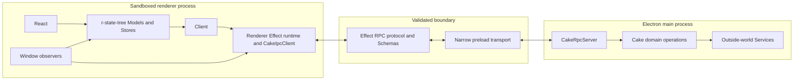

# Cake Effect architecture

This document is the normative technical architecture of Cake. See
[`cake-vocabulary.md`](./cake-vocabulary.md) for canonical terminology and the
[documentation map](./README.md) for document responsibilities. Feature behavior
and operational evidence belong in the linked focused guides.

## Architectural model

Cake is one logical application with a shared backend and privilege-separated
hosts. The diagram shows local Electron: main and each renderer window have
separate JavaScript heaps and Effect runtimes, joined through Effect RPC. The
standalone Node host reuses the backend graph; browser and remote Electron
clients use the same contracts over the network rather than the local preload.



There is one r-state-tree per renderer window and one renderer Effect runtime
hidden behind renderer infrastructure. Main contains an Effect service graph,
not another state tree. A Layer, Scope, Fiber, Store, Model, or service object
never crosses the process boundary.

## The core separation

Cake uses three primary implementation categories.

### Services touch the outside world

A Service is an Effect Context capability representing an external system,
native boundary, persistence boundary, or process transport. Services expose
Effects and Streams and own resources through Scope where necessary.

Primary Services are:

- `CakeSessionRuntimes`, `PiModels`, and `PiAgentResources`;
- `Git`;
- Effect Platform `FileSystem`, `Path`, `HttpClient`, and command execution;
- focused typed storage Services;
- `VsCodeServer`;
- `Terminal`;
- `Electron`;
- `InlineWidgets`;
- `CakeIpcClient` in the renderer and `CakeRpcServer` in main.

Cake does not introduce generic abstractions for dependencies it has chosen
concretely. In particular, `VsCodeServer` exposes VS Code-specific behavior;
there is no editor-neutral service.

### Domain modules implement Cake business logic

Cake domain modules contain free, named Effect operations. They yield Services,
combine their capabilities, and enforce product policy.

```ts
export const create = Effect.fn("ManagedWorktrees.create")(function* (
  input: CreateManagedWorktreeInput,
) {
  const git = yield* Git;
  const storage = yield* WorktreeStorage;
  const piModels = yield* PiModels;
  // Cake naming, creation, rollback, and persistence policy
});
```

Domain modules are not Context services. Pure policies may live beside the
Effect operations that use them.

Substantial Cake workflows live in named backend operations. Runtime assembly,
Pi callbacks, and RPC handlers connect callers to those operations, adapting
inputs, caller context, cancellation, and results. Keep small adaptations inline;
do not add forwarding Services or a generic workflow engine. An operation may
compose the capabilities needed to enforce its policy without being divided
merely because it involves several entity types. Family message routing, for
example, keeps reply selection, correlation, admission, delivery, and receipt
bookkeeping together in `sessionFamilyMessaging.route`, behind a thin runtime
callback.

This does not leave live workflow state ownerless. Existing process-scoped
capabilities retain queues, operation state, and Fibers; domain operations supply
Cake policy. For example, `worktreeLandings` owns landing semantics while its
coordinator owns the repository queue and accepted operation lifetime. Storage
Services own persisted records, and renderer Stores own local presentation.
`src/layers/` composes domain callbacks with capabilities without reversing
Service dependencies. These are existing ownership roles, not a requirement to
add a new abstraction or one coordinator per operation.

Representative modules are:

```text
application
projects
conversations
projectSessions
cakeChats
discussionSessions
subagents
modelPresets
utilityWork
managedWorktrees
reviews
artifacts
workingDirectoryTerminals
```

Shared conversation functions live in `conversations`; Project Sessions, Cake
Chat Sessions, Discussion Sessions, and Subagent Sessions do not implement
parallel Cake-owned conversation engines. Regular Pi and Pi Durable are distinct
external backends behind these shared operations; their persistence and recovery
guarantees remain different. Kind-specific modules own creation (`start`),
lifecycle, catalog metadata, and the acquire options that attach Cake policy to
the shared conversation hooks (`admitTurn`, `onSessionChanged`,
`onTurnSettled`). Once a Project, Cake Chat, or Discussion Session exists, the
renderer prompts, queues, steers, stops, edits, and configures it through the
one `sessionChats` group addressed by its Pi Session ID.

### Renderer infrastructure adapts RPC; Stores own application state and logic

The window's renderer infrastructure owns `CakeIpcClient` and the Effect
runtime. A permanent typed `Client` executes semantic commands as
Promises and propagates optional `AbortSignal` cancellation to Effect Fiber and
RPC interruption. The runtime's common observation primitive consumes RPC
Streams and returns cancellation handles to focused window-owned observers. The
Model observer applies authoritative snapshots to stable r-state-tree Models
with `applySnapshot` and reduces subsequent ordered Events transactionally,
using direct, batched Model mutations for incremental entity changes. Separate
application-state, agent-availability, and VS Code observers apply their streams
to the Stores that own those projections. Renderer bootstrap attaches these
observers and window snapshot persistence to the mounted Root Store; none is a
Store.

A window-owned RootProjection Model owns the authoritative data projections currently
loaded by that renderer independently of Store and React lifetimes. It owns canonical
LLM identities and resource identities once; sessions select LLMs through model references.
Session-owned model options and resource usages reference those shared identities while
retaining runtime-specific authentication, capabilities, discovery, and activation data.
Session Stores receive these Models as dependencies. Loaded Project Session identity
is independent from observation lifetime: pins and bounded warm observations follow
the renderer's session-retention policy.
Evicted projections release transcript data, and persisted loaded identities do not
demand subscriptions at startup. Window teardown first stops native events and Model
synchronization, then disposes the Store tree, and finally disposes the Models.

Renderer Stores read those Models, invoke `Client`, and own window-local
application/UI logic and repeated-call policy. They do not import Effect,
`CakeIpcClient`, RPC definitions, Pi, Git, storage, Electron main
implementations, or Cake domain operations.

React renders Store and Model state and invokes Store intents. React does not
construct RPC requests or subscribe directly to main-process event sources.

## Main and renderer runtimes

### Main runtime

Electron main selects `userData` and synchronously claims its single-instance lock
before constructing the production graph or awaiting Electron readiness. A denied
secondary launch exits without acquiring backend or native runtime resources.
The primary creates one production `ManagedRuntime` from the saved host selection.
Local mode uses `MainLive`; remote mode uses `RemoteMainLive`, acquiring only actual
native capabilities and device-local presentation storage, with no Pi/backend workers.
Host changes require confirmed relaunch. The remote renderer's single runtime composes
the existing network and preload clients behind typed group routing; Stores remain
transport-independent. Both local Electron and the standalone Node host acquire the same `makeBackendLive` graph;
there is no second local/headless implementation or per-endpoint runtime registry.

```text
MainLive
├── BackendLive
│   ├── FoundationLive           # platform, storage, Pi, Git/worktrees, projects, client state
│   ├── HostLive                 # optional real native capabilities supplied by Electron
│   ├── SessionWorkflowsLive     # session environments, runtime hosts, coordinators
│   ├── InitializedLive          # application state and registered-project access
│   └── BackgroundWorkersLive    # scheduled delivery and Session Family recovery
├── SharingLive                  # live desktop-local attachment to that backend Context
└── RpcLive                      # the host-supplied Electron Effect RPC endpoint
```

Shared startup subgraphs use `Layer.suspend` as a memoized composition boundary.
Memoizing leaf Services does not memoize `merge`/`provide` composites: repeatedly
traversing a shared diamond graph otherwise retains redundant Scopes and finalizers.
These boundaries share the graph within the existing process runtime and MemoMap;
they do not introduce another runtime or change Service ownership and shutdown.

The Node host supplies `Layer.empty` for native capabilities and can explicitly enable
the standalone backend WebSocket endpoint and basic browser asset serving. The
backend owns VS Code servers and companion commands; the network listener forwards
only a live desktop's lease-scoped code-server workbench, while `RemoteMainLive`
owns native views without acquiring a backend. URL opening and rendered-widget
capture are optional at their use boundary and fail explicitly when absent;
ordinary Project Session acquisition needs none of them. Terminal ownership is in the backend but PTYs are
lazy. Window persistence, attachment dialogs, native views and protocol serving
remain in the Electron host.

Project Session lifecycle is free domain policy in `projectSessionLifecycle`, not a capability or
Layer in this graph. These are ownership-oriented capability groups, not separate runtimes or
service facades. They
reuse the same Layer values throughout the graph, so Effect Layer memoization shares each
process capability and resource even when more than one feature group depends on it. Background
workers and RPC acquire only after the session workflow graph is available, and every scoped
resource remains owned by the one `MainLive` process Scope.

`MainApplication` is the Effect program for Electron startup, window lifecycle,
RPC registration, and shutdown. Asynchronous native window-close notifications
enter a process-scoped queue. The independent cleanup operations retain bounded
lifetime without being serialized, and different windows also clean up
independently; shutdown interrupts the scoped consumer and its in-flight
children. Native close-veto callbacks that require an
immediate result remain synchronous, and synchronous manager notifications are
queued into their owning Layer's ordered Effect consumer.

`src/backend/BackendLive.ts` is the shared production backend composition root.
It initializes durable application state and registered-project access before
starting workers or admitting host endpoints. `src/main/MainLive.ts` adds actual
native capabilities and IPC to that one graph. `src/main/main.ts` supplies
Electron/assets/configuration, creates the one `ManagedRuntime`, and starts
`MainApplication`. `src/server/main.ts` uses `NodeRuntime.runMain` with the same
backend Layer, explicit `CAKE_HOME`, and signal-owned shutdown; its process Scope
owns workers and runtime finalization. See [headless backend development](../development/headless-backend.md).
Ordinary Layers and their built-in memoization are the composition mechanism. Cake does not introduce an OpenCode-style custom Layer graph until
concrete composition or replacement problems justify it.

A minimal bootstrap Layer can start the application shell without loading
project resources, VS Code Server, terminals, or Project Session runtimes.

### Renderer runtime

Each renderer window has one small runtime providing `CakeIpcClient` over the
validated preload transport. The basic browser entry uses the same renderer runtime
boundary over the pinned Effect RPC socket protocol and shared schemas instead;
connection hooks project actual connected/disconnected state into its tab-owned shell. `Client` and the renderer runtime's narrow
Stream observation helper are the only ordinary application paths that execute
that client. The
runtime is created once, lives for the window, and is disposed on window
teardown.

`Runtime` keeps its `ManagedRuntime` private and exposes only
`execute(effect, signal?)` and `dispose()`. Commands, Model synchronization,
focused Store observation, native-event Streams, and the RPC smoke harness
all use that execution boundary. It forwards cancellation without translating
failures; command error presentation remains in `Client`, and the
runtime's Stream observation helper retries each failed Stream independently
with an Effect Schedule. Browser observations reconnect through fresh snapshots;
command execution has no retry/replay policy. A failed submission receipt is reported
as uncertain until the user deliberately reconciles it. The browser Client rejects
unsupported native/window/auth operations before dispatch and routes external links
to its local host. Browser bootstrap never attaches WindowStatePersistence.

ESLint restricts Effect execution APIs to the explicit boundary files listed in
`eslint.config.js`. The main process entry point executes `MainApplication` and
owns runtime disposal. Composition adapters execute only the Promise callbacks
that Pi requires, using the narrow dependency Context captured when the adapter
is built and forwarding Pi's `AbortSignal`. Managed Worktree creation, repository
serialization, landing queues, rollback, and persistence are native Effects owned
by the process-scoped capability and domain workflows. Domain functions, RPC handlers, Electron lifecycle processing,
and VS Code state propagation compose Effects instead of executing them. Runtime construction is restricted to
`main.ts` and `runtime.ts`. Tests may execute Effects in test
infrastructure; the ReviewStorage test constructor therefore lives under
`tests/`, not production source. `Stream.runForEach` and other Stream consumers
construct Effects and are not runtime execution APIs.

```text
Runtime
└── CakeIpcClientLive
    └── Effect RPC client protocol over preload
```

Renderer state stays in r-state-tree Models and Stores, not in the Layer or
runtime. The runtime is an infrastructure implementation detail, not the Store
dependency-injection system.

## Effect RPC over Electron

Cake uses Effect 4's `effect/unstable/rpc`; it does not maintain a competing
request/stream/cancellation framework.

The shared RPC definitions use Effect Schema and group capabilities such as:

```text
projects
sessions
cakeChats
reviews
artifacts
managedWorktrees
modelPresets
terminals
vscode
widgets
electron
windowState
```

Inside renderer infrastructure, `CakeIpcClient` is one Effect Service exposing
those named groups:

```ts
const client = yield * CakeIpcClient;

yield * client.sessions.create(input);
yield * client.managedWorktrees.land(input);
yield * client.electron.openExternal(url);

const updates = client.sessions.observe(sessionId);
```

`CakeIpcClient` derives its grouped methods and call results from the shared RPC
Group and the generated Effect client. It has no independently handwritten
operation interface or forwarding list. Void payloads become zero-argument
methods; other payloads retain their decoded schema types. Small explicit
payload adapters derive their argument types from those same RPC definitions.
Focused native-event aliases remain renderer infrastructure for local/remote
Stream composition.

The Promise `Client` derives ordinary command signatures with one mapped type
and builds their forwarding with one schema-driven adapter. Streaming RPCs are
excluded from this command adapter; one-shot synthesis has an explicit consumer.
Semantic payload adapters supply their own argument arity, so optional and
multi-argument calls still append `ClientCommandOptions` without sending them
as RPC payload. All commands continue through the shared cancellation, error,
host-capability, and uncertain-delivery policy. Result projections, attachment
uploads, native substitutions, and correlated acceptance checks stay explicit.

The protocol provides:

- Schema-validated payload, success, failure, and stream element types;
- generated Effect client operations;
- streaming RPCs;
- interruption and cancellation;
- server handlers and Layers;
- RPC middleware and correlation metadata.

`CakeRpcServer` constructs the shared handler/middleware endpoint and requires a
host-supplied `RpcServer.Protocol`. Electron's `MainLive` supplies its IPC protocol.
The endpoint acquires no backend Layers: additional endpoint Scopes can consume
an already-acquired backend Context without owning its lifetime. Closing an
endpoint interrupts its requests and observations, not the backend's owning Scope.
The standalone Node host now supplies an opt-in WebSocket listener using the pinned
Node socket server and Effect RPC socket protocol. `BackendRpcServer` composes the
backend-capable shared handlers; it requires no Electron or WindowStateStorage.
Desktop-only groups remain in the complete local `CakeRpc`. The network protocol
replaces untrusted connection/correlation headers case-insensitively and cleans up
connection-owned state on socket loss. `ClientConnections` allocates process-wide logical
IDs across sockets and IPC, independently of native WebContents IDs. Native adapters
resolve the explicit mapping only at their boundary. Desktop Settings can attach/remove
that same network listener at runtime through a local-only `DesktopSharing` capability;
its process Scope, not the calling RPC Scope, owns the attachment. Listener closure does not close the backend
or stop accepted turns. Reconnection re-observes snapshots without replaying mutations.

The desktop continues to use its Electron-specific RPC transport:

```text
Effect RPC client protocol
→ frozen preload bridge
→ Electron IPC
→ Effect RPC server protocol
```

Preload is deliberately mechanical. It exposes no raw `ipcRenderer`, performs
no Cake business logic, and accepts only the protocol transport messages.
Both receiving boundaries decode untrusted values. Remaining outside-world
commands are partitioned into the `electron`, `filesystem`, `workspaces`,
`managedWorktrees`, `terminals`, `vscode`, `artifacts`, and `widgets` RPC groups.
Each operation carries its semantic payload directly; there is no generic request
envelope or second dispatcher protocol inside Effect RPC. Focused application, artifact, terminal, embedded-editor, and surface Streams
carry renderer-connection-scoped native events to their window-owned consumers.

Main RPC handlers are thin adapters to domain operations. They do not own
business logic. Effect Schema decodes requests, results, failures, and Stream
elements once at the process boundary; already-decoded values use ordinary
TypeScript types internally and are not reparsed at each function call. A
process-scoped renderer-request coordinator owns transient reverse-request
correlation and validates the expected Cake Session and renderer connection
before completing a request. It publishes only through the existing native-event
Streams and completes only through the existing Effect RPC response methods.
Each renderer connection owns the Scope of its streaming RPCs and in-flight
requests. Closing a window interrupts those subscriptions and requests.

A long-lived operation with independent domain lifetime returns a stable ID or
handle once accepted and reports later progress through a Stream. Interrupting
the short acceptance request is distinct from issuing the domain's explicit
abort command.

### Typed failures and committed transitions

Expected failures use specific Effect error variants that retain the facts needed
for application-level handling. A workflow that commits its primary transition
before follow-up work must distinguish a known pre-commit refusal from failure
after that commit. Do not collapse both into a generic exception or a boolean
meaning “nothing changed.” Feature-specific tagged errors are sufficient; this
does not require a universal result framework, rollback engine, or durable journal.

Preserve those variants through the RPC error Schema and the renderer's Promise
client. `ClientError.domainFailure` carries only explicitly allowlisted, validated
domain outcomes; ordinary Stores remain Effect-free and do not inspect arbitrary
transport objects or parse error strings. Once a domain outcome is received, a
later aborted signal must not replace it with generic cancellation. Actual
transport interruption or an operational failure can still leave the result
uncertain; neither is proof of rollback or permission to replay a mutation.

For Project Session resolution, `ResolutionRejected` denotes a known pre-commit
policy refusal; `ResolutionCleanupFailed` confirms committed resolution and
identifies the observed checkout-cleanup failures. Callers perform normal
post-resolution presentation for the latter while reporting cleanup separately.
See [resolution outcomes](./s1-session-contract.md#resolution-outcomes) for the
focused contract and [the implementation record](../proposals/backend-workflow-refinement.md)
for integration status.

## Pi services

Cake exposes focused Pi capabilities, not one god service. `PiLive` supplies the
regular coding-agent integration; `BackendLive` also provides `CakeChatDurable`
for the permanent coordinator. Raw SDK types stop in `services/pi` or
`services/pi-durable`, respectively. The latter uses Pi Durable's SQLite adapter,
not a JSONL mirror or a Cake-owned SQL transcript store. See
[Pi backends](./cake-architecture.md#pi-backends) and the
[Durable storage contract](./cake-storage.md#permanent-cake-chat).

### `CakeSessionRuntimes`

`CakeSessionRuntimes` is the Pi adapter service for discovery plus keyed, scoped
Cake Session Runtime access. The rename from `PiSessions` is deliberate: its
acquired resource is not a raw Pi service object. Each `CakeSessionRuntime`
wraps exactly one Pi Session Runtime for exactly one Cake Session, applies that
Cake Session kind's capability profile and hooks, and returns a scoped
`CakeSessionHandle`. Genuine Pi-owned discovery inputs, errors, and snapshots
remain `PiSession*` values where they describe Pi authority:

```ts
interface CakeSessionRuntimes {
  readonly sessionIds: (query: PiSessionQuery) => Stream.Stream<string, PiSessionError>;

  readonly catalog: (query: PiSessionQuery) => Stream.Stream<PiSessionSummary, PiSessionError>;

  readonly inspect: (target: PiSessionTarget) => Effect.Effect<PiSessionPreview, PiSessionError>;

  readonly acquire: (
    options: CakeSessionRuntimeAcquireOptions,
  ) => Effect.Effect<CakeSessionHandle, PiSessionError, Scope.Scope>;
}
```

The regular-Pi IDs-only stream discovers session identities from filenames without statting or parsing
transcripts; lifecycle workflows use it when they do not need display metadata. The catalog stream
discovers sessions from filename and filesystem metadata, then opens each Pi JSONL transcript to
derive its bounded title from the latest session-name entry or first user message. Pi is the sole
durable title authority. Runtime title changes publish scoped title events so active
renderer projections update immediately, including started sessions still awaiting
registration in the disk-backed catalog. Cake owns a versioned resolution index and
separate project routing metadata; Pi files remain in their normal directory.
Active catalogs load resolved IDs once and filter filename metadata before opening
Pi transcripts for titles. Resolution belongs to standalone sessions and family roots.
Child transcripts stay in place and inherit the root's metadata-derived resolution through domain policy. Family catalog and conversation
Streams project this derived state; renderer Models are window-lifetime read projections, not
independent child lifecycle authorities. Root transitions and turn admission share the family
lock. There is no persisted member-resolution synchronization journal.

A `CakeSessionHandle` is the scoped capability for its Cake Session Runtime. It
exposes a purpose-built Conversation observation Stream and operations such as
prompt, steer, follow-up, abort, execute command, set model, compact, fork, and
reload. The Handle is not the Cake Session's identity or persistence record. Runtime acquisition is keyed and scoped: concurrent consumers of one
session share one process-local runtime, and the final release disposes it.
The permanent coordinator retains an application-scoped lease after assembly;
closing its pane does not release its final lease. Its document-kernel readers
can inspect history without constructing a live Harness. Available operations
follow the kind's capabilities; shared handles do not grant Cake Chat Project
Session fork, rename, or resolution behavior. Conflicting runtime-defining options
never silently reconfigure an acquired runtime.

Keep fixed runtime configuration distinct from live application policy. Session
identity, Working Directory, and engine/capability profile belong to acquisition;
mutable family membership and lifecycle eligibility do not become fixed merely
because a runtime captures callbacks. Query those authorities when an operation
executes. `projectSessionAgentPolicy.read` supplies current Project Session family
information and agent fork/deferral policy; its snapshot is not an admission
permit. Operations retain authoritative eligibility checks and existing admission
locks where required. Do not recreate runtimes or refresh their system prompts
merely to reflect membership changes. Deferred intents retain their original
scope of authority rather than gaining broader rights as relationships change.

Cake domains choose a semantic capability profile:

```text
ProjectSession
CakeChatSession
DiscussionSession
SubagentSession
```

The Pi adapter translates that profile into tools, extension policy,
permissions, and supported extension UI. Callers do not manually assemble Pi
internals.

Pi Extension execution is session-bound and belongs to `CakeSessionRuntimes`. There is
no separate public `PiExtensions` service.

Feature agent operations live beside their Cake domain workflows. The shared backend
injects constructors from `layers/CakeOperations.ts` into the regular-Pi and Durable
Services. That composition consumes feature controls and supplies each engine runtime
with an already-configured `operations(bridge)` factory; engine options contain only
Pi configuration and callbacks used directly by the adapter, not the feature-control
bundle. Neither engine adapter imports feature implementations. `contracts/agent/`
owns operation definitions, execution context, results, runtime APIs, and the
product-facing callback/options contract.
Domain operations depend on those contracts rather than Pi runtime implementation files.
`cake-operation-registry` implements the tool protocol: envelope validation, progressive
help, result/image limit enforcement, and dispatch. The engine adapter supplies live
callback capabilities and projects SDK tool callers to Cake-owned scalar context before
invoking domain operations. Workflow authoring guidance lives in the workflows domain;
staged artifact text editing remains a Pi Service because it uses Pi's authoritative edit tool.
The boundary lint forbids domain imports from `services/pi/runtime`; domain-used Pi
capabilities live at the Service's top level. Composition and engine adapters may still
connect runtime implementations directly.

### `PiModels`

`PiModels` owns the complete Pi model capability:

- separate chat and typed image/classifier catalogs and authentication projection;
- model availability and supported thinking levels;
- reference resolution;
- bounded, non-session completion through Pi's model runtime.

It accepts concrete Model Selections and knows nothing about Cake Model Preset
names. Conversational execution always goes through `CakeSessionRuntimes`. Image generation
and classification stay in Pi's native codemode API. Cake's backend ApplicationState
stores advisory non-chat references, and eligible Project Session operations resolve
them against the session's native catalog without a second executor or credential cache.

### `PiAgentResources`

`PiAgentResources` loads and reloads context-dependent non-model resources:

- skills;
- prompt templates;
- configured Pi Extension sources;
- discovery and load diagnostics.

Runtime commands and executable contributions are authoritative only after a
Pi Session Runtime loads them, so they are exposed through the session handle.

### Pi projection boundary

Raw regular-Pi objects and events stop inside `services/pi`; Durable SDK objects
stop inside `services/pi-durable`. Pure translation modules map each backend's
supported history, events, resources, errors, and queue/inbox state to Cake-owned
conversation values. Ordinary Pi forks preserve reconstructed
compacted work logs through a schema-validated hidden Pi custom provenance
entry that only the display projection consumes; it does not enter Pi's model
context. Pi Service contracts never depend on a Project-Session projection or
RPC payload type. No other Cake module imports Pi packages directly.

## Session observation and Streams

Pi remains the durable transcript authority. A regular-Pi session observation
conceptually combines:

```text
Pi session history reconstructed through Pi from JSONL
+ live events from the active Pi Session Runtime
```

Permanent Cake Chat instead reads SDK-owned originals plus live/inbox state;
its summary nodes and resets are not GUI history. Original-history pagination
and recovery follow the [Durable storage contract](./cake-storage.md#permanent-cake-chat).
Neither adapter persists a second Cake transcript or duplicate durable event
log, and Cake never tails or writes Pi JSONL directly.

A Conversation observation begins with one coherent snapshot and continues with
ordered typed events without a subscription gap:

```ts
type ConversationUpdate =
  | {
      readonly _tag: "Snapshot";
      readonly revision: number;
      readonly snapshot: ConversationSnapshot;
    }
  | {
      readonly _tag: "Event";
      readonly revision: number;
      readonly event: ConversationEvent;
    };
```

A Project Session's known target is sufficient to start the independent
`conversations.observe` subscription for its primary Conversation. Discussion,
subagent, scheduled-message, artifact, review, lifecycle, Project, and Session
Family authorities are read or observed only by the focused surfaces that need
them. Conversation and focused-authority updates never rebuild a Project
Session-shaped payload or replace Conversation Model identity.

Conversation Events cover messages and the broader runtime lifecycle: turn
state, message parts, tool execution, model selection, usage, compaction,
commands, extension UI, and failures.

A Stream is not automatically a durable log. If a renderer reconnects or a
live transport cannot continue coherently, main asks Pi for a new authoritative
snapshot and resumes observation. Cake does not invent history to fill the gap.

The Pi adapter has one underlying runtime listener per acquired runtime and
multicasts updates to its scoped consumers. Domain functions project Pi updates
into Cake Session updates before RPC. The renderer Model observer maps the
RPC Stream into Model snapshots and applies them.

```text
Known Project Session target → conversations.observe
Pi → CakeSessionRuntime → Conversation snapshot/event projection
  → Model observer → renderer Conversation Model → Stores/React

Focused review / subagent / artifact / family / schedule authorities
  → their own Models and Stores (never through Conversation)
```

Terminal output, filesystem observation, and other live sources follow the same Scope and Stream principles but define their own event
vocabularies.

## Resource lifetimes and concurrency

Effect Scope mirrors real ownership:

```text
Main process Scope
├── renderer connection Scopes
├── Project resource Scopes
│   ├── filesystem observation
│   ├── Git-related refresh work
│   └── VS Code Server
├── active Cake Session resource Scopes
│   ├── Pi Session Runtime and listener
│   └── session-bound extensions and Cake tools
├── renderer-window Terminal resources
│   └── handles grouped by canonical Working Directory
└── operation Scopes
```

Keyed scoped caches deduplicate concurrent acquisition of Project resources,
Pi Session Runtimes, VS Code Server instances, and other keyed resources. Scope
answers lifetime; it does not answer repeated-call behavior.

Every asynchronous intent separately declares a concurrency policy:

- serialize per key;
- share one in-flight operation;
- interrupt previous;
- latest result wins;
- reject while active;
- queue;
- bounded parallelism;
- independent execution.

Examples include serializing Pi turns per session, bounding Subagent Sessions,
serializing durable scheduled-message mutations, rejecting concurrent landing
commands for the same Managed Worktree, and queueing distinct Managed Worktree
landing workflows in FIFO order per Repository. A loading flag
is presentation state, not a concurrency policy.

## Filesystem, Git, worktrees, VS Code, and terminals

Effect Platform's `FileSystem` owns filesystem operations and observation.
`Git` owns Git commands and Git facts. Cake domain operations decide how
filesystem events trigger debounced Git refreshes.

Managed Worktree records are main-owned persisted authority. Their record and
Project Session context schemas live in `contracts/worktrees/managed-worktree-data.ts`;
storage, Services, Project Session projections, and RPC compose those owned
values rather than defining or importing an RPC-owned record. `ManagedWorktrees`
exposes one Schema-validated current-first Stream: a coherent record Snapshot followed
without a subscription gap by ordered lifecycle upserts. Each renderer's Model observer
reduces that Stream into its window-lifetime `WorktreeCatalog`; `SessionSummary` stores no
mutable lifecycle copy and joins by Working Directory. A pending creation fact exists only
until the authoritative entity arrives.

A landed record's `landedSourceCommit` is the acknowledged source-history boundary,
not its original `baseCommit` or the target's current tip. Status and landing exclude
both that boundary and current target history when counting later source commits.
Cake replays only the later range onto the target and advances the boundary to the
new replay base; a conflicted replay retains a pending base until Git ancestry proves
completion (an abort retains the old boundary). Successful landing checkpoints the
source tip for both preserve and squash strategies. Pre-checkpoint preserve records
can recover their boundary from source ancestry in the target reflog, including
conflict-resolved target rebases. Missing historical evidence or old squash records
remain conservative rather than guessing a source tip and hiding later work.

Landing, cleanup, and resolution policy are backend-owned. The process-scoped
landing coordinator retains accepted operations independently of renderer lifetime;
renderer Stores start, retry, dismiss, and present that work. Repository queueing,
persisted pauses and merge-and-resolve intent, automation prompts, and partial
cleanup results belong to the [worktree domain](../../src/domain/worktrees/).
Queue progress is process-local; `queued` is published only after the engine inserts
an operation into its FIFO, before waiting for promotion. Renderer status refreshes
coalesce without dropping an update received in flight. Persisted pauses can be
adopted after restart, including squash-message requests; explicit dismissal clears
the durable landing pause, while terminal-operation acknowledgement cannot discard
durable resolve intent. Recovery must not resolve an older landed record while a
later operation is active or while the checkout has unlanded work.

Landing and rebase require the source checkout to remain on its recorded branch.
Dirty-target approval applies only to preserve landings: squash commits require a
clean target index and checkout. Automatic resolved cleanup refuses dirty,
conflicted, or newly committed source work and uses non-forced checkout removal.
Removing a parent requires removing its extant child worktrees first. Cleanup Git
failures remain visible rather than being reported as successful removal;
successful removal also releases the checkout's landing reservations. Project-wide
resolved-worktree cleanup uses this same safe, restorable retirement path, not
forced discard.

A merge-and-resolve operation remains `landed` when Git landing and session
resolution commit but checkout cleanup fails. Its optional `cleanupFailures`
projection carries warnings, and the completed resolve intent is cleared as on
ordinary success. Do not retry successful Git landing to repair checkout cleanup;
see [resolution outcomes](./s1-session-contract.md#resolution-outcomes).

`WorktreeStorage` is separate from `Git`:

```text
Git
  owns Git Worktree existence and repository state

WorktreeStorage
  owns Cake Managed Worktree metadata

managedWorktrees domain module
  combines Git, WorktreeStorage, and utility model policy
```

`VsCodeServer` is a concrete Cake Service. It owns binary discovery or
installation, per-working-directory process lifecycle, ports, health, VS Code
URLs, Source Control commands, source navigation, and Cake review annotations.
Cake does not hide it behind a generic editor abstraction.

`Terminal` owns PTY resources; `workingDirectoryTerminals` associates their handles
with canonical Working Directories in renderer-connection Scopes. Shared-directory
tabs, disconnect cleanup, retirement checks, and late-open handling belong to that
domain workflow. Retirement inspects and closes terminals across all connected
windows before removing the checkout; canonical identities survive checkout removal
and late opens cannot revive retired resources. Visibility is renderer state,
not PTY lifetime.

`Electron` owns concrete native capabilities such as windows, dialogs, external
URLs, filesystem reveal, and application lifecycle. A renderer Store may call
a semantic `Client` Electron operation for a simple native action. It
uses a domain operation exposed through RPC when Cake business policy or
multiple Services must be coordinated.

## Typed storage and snapshots

Cake uses focused storage Services rather than a generic untyped key/value
service:

```text
ApplicationStorage
WindowStateStorage
ScheduledMessageStorage
WorktreeStorage
ReviewStorage
ArtifactStorage
SessionArchiveStorage
```

Each Service owns its document Schema, version envelope, migration sequence,
location, atomic-write behavior, and typed errors. Shared internal file helpers
may implement atomic writes, but domain code uses focused storage Services.
`ArtifactStorage` owns one global lineage catalog and content-addressed blobs.
Its operations expose immutable exact reads, revision publication with a typed
`expectedLatestRevision` conflict, and session/family links that either follow
latest or pin a revision. A single Service-owned semaphore serializes atomic
catalog replacements. Request records are not artifact-storage entities.

Cake-owned documents default to versioned files; the envelope, migration order,
and atomic-write contract are defined in [storage ownership](./cake-storage.md#versioning-and-migration).
Pi's JSONL and Durable SQLite stores retain their own formats. An atomic document
write is not a transaction spanning Cake metadata, Git, and Pi; see the
[workflow recovery boundaries](./cake-storage.md#workflow-recovery-boundaries).

r-state-tree snapshots are the serialization boundary for renderer-owned state:

```text
startup: versioned file → WindowStateStorage RPC → mount RootStore with snapshot once
runtime: onSnapshot(RootStore) → Client.windowState → versioned file
```

Window snapshot persistence is renderer infrastructure outside the Store tree.
It never applies storage to an already-mounted Store.

Only fields explicitly marked with r-state-tree snapshot metadata persist. Full
Pi transcript projections, live resources, projection subscriptions, pending
operations, and transport state do not. Hydration loads and migrates storage,
validates it, mounts or applies the complete snapshot before Store effects
activate, chooses an explicit fallback on failure, and only then subscribes to
future snapshot changes for debounced writes. Snapshot APIs do not replace
storage policy.

## Renderer Models, Stores, and React

Renderer Models live in `src/renderer/models`. They contain validated reactive
entity state, identity, owned entity children, references, synchronous
invariants, and pure queries. They contain no Services, Streams, Fibers, or
persistence policy.

Renderer Stores live in `src/renderer/stores`. They compose as stateful behavioral
components according to application ownership and lifetime, not as a fixed number
of global containers. Many isolated Stores are appropriate when the application
has many responsibilities. Evaluate encapsulation and cohesion, not Store count
or tree depth; do not consolidate independent owners merely to reduce files.

They own:

- renderer application state and application/UI logic;
- loading, success, and renderer-facing failure state;
- Promise-based intents and repeated-call policy;
- Store-owned workflow resources, timers, and cancellation;
- keyed child Store projections;
- explicit window snapshot fields.

The single Model observer lives in renderer infrastructure. It owns Model
observation demand and each observation's cancellation handle. It delegates RPC
Stream execution and failed-stream retries to the renderer runtime's narrow
observation helper. Each Stream retries independently with an Effect Schedule.
Each source owns its current-first, ordered update
contract; the observer does not implement a second revision protocol.
It applies each validated Snapshot with `applySnapshot` and reduces each
subsequent Event transactionally, using direct reactive batches for incremental
entity changes; it is not a second application state system. Renderer bootstrap
attaches it to the mounted Root Store and RootProjection so it can watch observation
demand and update the corresponding projection children. Shared identities are registered
before session references are hydrated, in the same reactive batch. Pi message/tree IDs,
resource diagnostics, resource usages, model options, and artifacts use unique renderer
IDs containing their owning session (or discussion) and source ID. Model identity is always the unique identifier, never a separate identity key.
Use `id` alone when the Cake and Pi identities are the same. Only split into `id`
and `piId` when Pi's session-local identity differs from Cake's tree-unique identity.
Session tree entries use `sessionId:piId`. Message projections use
`sessionId:partKey`: the existing Cake part key already distinguishes text,
reasoning, attachments, and other parts of a Pi entry. A Message's optional `piId`
is the actual Pi entry ID supplied by the transport, never the generated part key.
Pi entry references are explicitly named `parentPiId` and `firstKeptPiId` inside
Models and mapped to Pi contract field names at the boundary. Cake-generated
resource diagnostics use `diagnosticKey`, not `piId`. Provider model names remain
`modelId`. Do not add redundant `piId` fields to sessions or Cake-owned entities.
Source values remain unchanged at Pi/RPC boundaries. Artifacts have one renderer `id`,
composed from session and artifact identity; their received record remains transport data. Cake-created session, discussion, scheduled-message, and
subagent IDs are already globally unique within their Model class.
Canonical entities remain available for the window lifetime so unloading a session cannot
invalidate another session's references. Projection defects stop the
observation and offer an explicit retry; recoverable stream failures retry automatically.
Feature Stores and Models never access it.

The normal data and command paths are:

```text
CakeIpcClient Stream → Model observer → hydrate snapshot / reduce event → Store/React
Store intent → Client Promise → CakeIpcClient Effect → RPC
```

r-state-tree Models and Stores use the installed package's actual semantics:

- Models hold validated reactive projection data, identity, children,
  references, and synchronous invariants;
- Stores hold window-local application/UI behavior and explicit async state;
- one logical projection update is committed in one r-state-tree transaction;
- Store `AbortSignal` is passed to cancellable `Client` operations;
- Store disposal prevents late local commits, while the client translates abort
  to Effect/RPC interruption;
- Store effects own workflow-local subscriptions and timers, not authoritative
  entity observation Streams;
- snapshots contain only explicitly selected renderer-owned state.

The Model observer never lets arbitrary Effect Fibers mutate Models. Each
validated Snapshot is applied atomically and each Event is reduced
transactionally; incremental entity changes use direct reactive batches. The
Model observer interrupts replaced observations through their cancellation
handles, and retry starts a new source stream whose first value is an
authoritative Snapshot. The observer owns at most one active observation for
each loaded identity. Models remain passive
reactive data and know nothing about Streams or synchronization.

React mounts the root Store outside render, finds it through r-state-tree's
`StoreProvider`, and observes reactive reads with `observer`. Provider ancestry
is lookup, not Store lifetime. React keeps only DOM-local behavior and isolated
component state.

`RootStore` remains the window composition boundary. Bootstrap attaches focused
observers for event routing; Root does not subscribe to authoritative streams or
own every workflow. `NavigationStore` coordinates
session, pane, history, and surface navigation; a stateless typed command registry
dispatches application hotkeys to focused owners. Named product surfaces
retain focused Stores. Every chat surface uses the authoritative shared `Chat`
component and `ChatStore`.

## Source organization

Cake remains one application package. Process and dependency boundaries do not
require a monorepo split.

```text
src/
├── contracts/                # Feature-named shared schemas, errors, values, and pure codecs
├── services/                 # Outside-world capabilities and Live implementations
│   ├── pi/                   # Regular coding-agent adapter and shared runtime leases
│   ├── pi-durable/           # Permanent Cake Chat's Durable SDK adapter
│   ├── git/
│   ├── storage/
│   ├── vscode/
│   ├── terminal/
│   ├── electron/
│   └── widgets/
├── domain/                   # Cake product contexts containing cohesive free Effect modules and owned data
│   ├── application/          # Application mutation, catalog, and embedded-editor policy
│   ├── artifacts/            # Artifact workflows and lifecycle policy
│   ├── cake-chats/           # Cake Chat metadata, locations, runtime, lifecycle, and operations
│   ├── conversations/        # Conversation operations and cross-session delivery policy
│   ├── discussion-sessions/  # Discussion Session operations
│   ├── model-presets/        # Model Preset operations and Cake model-selection policy
│   ├── project-sessions/     # Project Session metadata, locations, runtime, lifecycle, and operations
│   ├── projects/             # Project errors and operations
│   ├── reviews/              # Review policy and operations
│   ├── scheduled-messages/   # Scheduled Message delivery policy and operations
│   ├── session-families/     # Session Family lifecycle and delivery policy
│   ├── subagents/            # Subagent Session controls and operations
│   ├── terminals/            # Working Directory terminal operations
│   ├── utility-work/         # Bounded utility-model operations and output policy
│   └── worktrees/            # Managed Worktree cleanup, landing policy, and operations
├── layers/                   # Production composition adapters joining domains to callback APIs
├── config/                   # Decoded process configuration values
├── ipc/
│   ├── protocol/             # Effect RPC groups using shared contracts
│   ├── client/               # CakeIpcClient and renderer transport Layer
│   ├── server/               # CakeRpcServer endpoint and shared handlers
│   └── transport/            # Electron RPC protocol adapters
├── backend/                  # Shared backend composition and initialization
├── server/                   # Standalone Node host and network endpoint
├── main/
│   ├── main.ts              # Electron host entry point and process runtime
│   ├── MainLive.ts          # Named production Layer capability/feature composition
│   ├── MainApplication.ts   # Effect-native Electron application program
│   └── BootstrapLive.ts     # Immutable platform bootstrap capabilities
├── preload/
├── renderer/
│   ├── main.ts               # window composition and teardown
│   ├── runtime.ts            # one window-local Effect runtime
│   ├── app-control/          # curated Cake application control bridge
│   ├── bootstrap/            # renderer assembly helpers
│   ├── client/               # permanent Promise Client adapter
│   ├── components/           # React presentation
│   ├── lib/                  # renderer-local pure utilities
│   ├── models/               # r-state-tree projection Models
│   ├── observers/            # Stream execution and focused observers
│   ├── persistence/          # one-way window Store snapshot persistence
│   ├── reducers/             # update-to-Model reducers
│   └── stores/               # r-state-tree application/UI Stores
└── utils/
```

Default to one cohesive file per domain module. Split a module around meaningful
internal concepts only when its implementation demonstrates the need; do not
create one file per operation by convention.

Dependencies flow as follows:

```text
renderer components → renderer Stores and Models
renderer Stores → Client
renderer observers → Runtime and their Model or Store owners
Runtime → CakeIpcClient
Client → CakeIpcClient ↔ shared RPC protocol ↔ CakeRpcServer
CakeRpcServer → domain operations → Services
```

`architecture/module-boundaries` in `tools/eslint/module-boundaries.js` enforces
these dependencies through the repository's ESLint configuration (`pnpm lint`):

| Source                                                    | Allowed application dependencies                                            |
| --------------------------------------------------------- | --------------------------------------------------------------------------- |
| Shared contracts, transport envelopes, and `utils`        | Shared values only                                                          |
| Process config                                            | Config and shared values                                                    |
| Services                                                  | Services, process config, and shared values                                 |
| Domain                                                    | Domain, Services, process config, and shared values                         |
| Composition Layers                                        | Backend wiring, domain, Services, config, and shared protocols/values       |
| Main, backend, server, and RPC handlers/server transports | Backend, composition, domain, Services, config, and shared protocols/values |
| Renderer                                                  | Renderer, RPC client infrastructure, shared protocols/values                |
| RPC clients/client transport                              | Client infrastructure and shared protocols/values                           |
| RPC protocols                                             | Protocols and shared values                                                 |
| Preload                                                   | Shared transport/contracts only                                             |

Services never import Cake domain modules or composition adapters. `src/layers/`
joins capabilities to domain callbacks or backend listener wiring; Services receive
callbacks through their own interfaces. Backend code cannot import renderer/client/preload
implementations, and renderer code cannot import backend/domain/Service/preload
implementations. Shared modules cannot become a transitive route around this boundary.
Node builtins (including bare imports), Electron, and Effect Node platform packages
are forbidden in renderer, client, protocol, and shared modules. Pi packages terminate
beneath `services/pi` or `services/pi-durable`.

The rule checks value and type-only imports, re-exports, static dynamic imports,
TypeScript import types/import-equals, and `require`. It normalizes relative paths,
absolute paths, the `@/` renderer alias, `src/` imports, directory imports, and Vite
query suffixes. Runtime-loaded extension URLs remain an explicit external-module
boundary, not statically resolvable application imports. Named client/envelope
transports are classified explicitly; new transport implementations default to backend.
The separate rule ID prevents narrower renderer restrictions from replacing these checks.

RPC payloads never expose raw Pi, Git, Electron, filesystem, Effect runtime, Store,
or Model objects. Extract shared values rather than granting type-only exceptions
or re-exporting backend declarations through a facade.

## Schema ownership

Schemas live beside the authority or boundary they describe. When both processes
or multiple architectural layers need the same value, its definition lives in a
feature-named shared contract rather than an implementation module:

```text
contracts/application/      application documents, configuration defaults, and catalog projections
contracts/conversations/    message envelope/reminder codecs and delivery projection vocabulary
contracts/pi/               Cake-owned Pi model, settings, and availability values
contracts/artifacts/        lineage values, projection metadata, and typed failures
contracts/worktrees/        Managed Worktree records, operation projections, and cleanup results
contracts/*/                other feature inputs, outputs, errors, and pure codecs shared across layers
services/*/                 internal capability values, storage migrations, and implementations
domain/                     internal Cake business values and workflow policies
ipc/                        protocol, client, server, and transport infrastructure only
ipc/protocol/               Effect RPC groups using shared contracts
renderer/models/            reactive projection schemas
```

Cross-process and persistence boundaries use Effect Schema. `contracts` does not
create a second authority: the originating subsystem still owns the facts. It is
not a generic `types` dumping ground or a place for Context Services, resource
ownership, workflow orchestration, or mutable application state. Shared pure
configuration defaults, projection derivations, and envelope codecs may accompany
their values; backend execution remains in domain/Services. Service-local schemas
need not move unless another layer consumes them. Data purity or a `-data.ts`
filename never justifies a reverse dependency into domain.

Shared cross-process inputs, projections, control schemas, and pure serialization
helpers live in feature-named `contracts/` modules. The application event and
request/success schema catalog lives in `contracts/application/cake-rpc-contract.ts`;
it contains shared data definitions, not RPC groups or transport code. `ipc/` has
no root data modules; the boundary lint rejects files outside its four
infrastructure directories and prevents Services/domain from importing protocols.

Pi message envelope codecs and exact presentation/response reminder formats
live in `contracts/conversations/`; coordination delivery workflows remain in
domain. Model selection tool schemas and preset input/projection/error schemas
live in `contracts/model-presets/` and preset
resolution remains domain policy supplied to Pi through a resolver callback.
The callback reads current application configuration at execution time. Artifact and widget workflow callbacks are composed in
`layers/ProjectSessionRuntimeHostLive.ts`; the Pi Service contract does not import
the composition implementation.

Application prompt schemas, current configuration wording, and override
normalization live in `contracts/application/`; non-chat model preference
references live in `contracts/models/`. Prompt rendering and the workflows that
choose when to use prompts remain in `domain/application/cake-prompts.ts` and
other domain modules. Storage migrations recognize a frozen snapshot of
historical wording; they never follow current prompt defaults. Pi consumes
preference references without owning their persistence or application mutation
policy. Pure Saved Draft extraction from a legacy window snapshot is shared;
filesystem persistence and versioned window migrations remain in storage Services.

`resolveCakePaths` accepts the already-resolved Pi agent directory. Host composition
calls the Pi adapter, keeping process configuration independent of Service code.
The listener-scoped `EditorBrowserPort` is a VS Code capability, and desktop-sharing
listener assembly lives in `layers/DesktopSharingLive.ts` rather than a Service
that imports backend composition.

## Security and extensibility

The renderer remains sandboxed with no Node globals, raw Electron IPC, raw Pi,
filesystem, or credentials. The backend validates trust, paths, and permissions
even when renderer input has already decoded. Model-presented artifacts remain
data and use validated or sandboxed protocols. The unfinished remote-access
feature currently assumes fully trusted clients; transport validation is not
client authentication or restricted sharing. See
[remote scope and security status](../development/headless-backend.md#scope-and-security-status).

## Testing and observability

Domain tests execute real domain Effects with test Service Layers. Service
integration tests exercise real external boundaries where practical. Renderer
workflow tests start at the real feature UI with real Models and Stores and a
controlled Promise `Client`; follow the [renderer testing guide](../development/renderer-store-testing.md)
rather than duplicating those workflows in direct Store suites. Observer tests
use controlled current-first Streams and assert identity, ordering, retry, and
disposal; reducer tests assert focused Model updates and preserved child identity.
Focused Electron tests exercise the complete renderer/preload/RPC/main path.

Domain operations and service calls use named Effects and tracing annotations
such as Project ID, Cake Session kind, Pi Session ID, Managed Worktree ID,
Terminal ID, RPC request ID, and subscription ID. Expected failures remain typed
Effect failures; defects are handled and logged at application boundaries.
